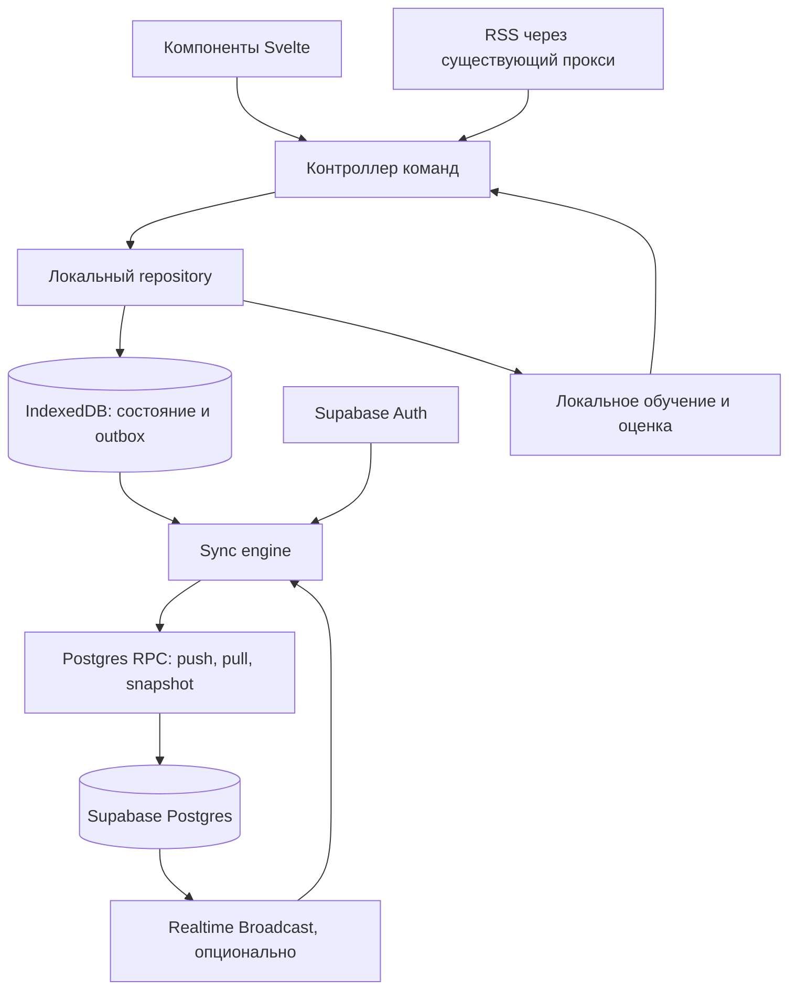

# Синхронизация Start. через Supabase

[К оглавлению](README.md).

**Статус: основной контур реализован, облачная настройка применена.
Обновлено: 13 ноября 2026 года.**

Подтверждено пользователем: бэкенд — Supabase; обучение рекомендаций остаётся
в браузере, история действий общая между устройствами; доступ — по сид-фразе
без email. У пользователя Free-план и заняты доступные проекты Supabase:
Start. размещается в существующем проекте рядом с другими приложениями.
Этот документ задаёт целевую архитектуру, протокол и последовательность
внедрения. Реализованы IndexedDB с миграцией, транзакционная очередь, SQL/RPC
и RLS, вход по фразе, polling, основные сущности и история рекомендаций.
Инструкция применения и точные границы текущего выпуска находятся в
[supabase/README.md](../supabase/README.md).

Физическая SQL-модель первого выпуска объединяет логические сущности из
раздела 5 в `start.records`; приватные таблицы хранят устройства, поколения,
журнал, receipts и снимки. Типы данных и родительские связи проверяет RPC.
Realtime, объединение заполненных профилей, staged replacement облака и
автоматическое удаление старой облачной истории остаются следующими этапами.
Импорт с заменой доступен в гостевом режиме; создание пустого облачного
профиля переносит локальные данные, подключение существующего сохраняет
гостевой профиль отдельно.

## 1. Основные решения

1. Приложение сохраняет гостевой режим. Для синхронизации создаёт случайную
   фразу из 12 слов; ввод той же фразы подключает другое устройство. Supabase
   Auth проверяет подпись ключа, полученного из фразы локально.
2. Интерфейс читает локальное состояние из IndexedDB. Изменение состояния и
   команда для отправки записываются одной локальной транзакцией.
3. Postgres хранит подтверждённое состояние аккаунта. Запись выполняется
   через RPC с журналом изменений, повторяемыми запросами и серверным порядком
   операций. Браузерные часы не определяют победителя конфликта.
4. Подписки, колонки, прочитанность, пользовательские настройки и история
   действий синхронизируются. Публикации по-прежнему загружает клиент через
   существующий RSS-прокси.
5. Realtime опционально сообщает, что появились изменения. Первый выпуск
   может читать журнал через RPC при фокусе, подключении и по таймеру.
6. Обученные веса, калибровка, embeddings и готовый список рекомендаций —
   локальные производные данные. Между устройствами передаются исходные
   действия и сохранённые наблюдения эксперимента.

Это позволяет внедрить бэкенд в существующий Svelte/Vite-клиент. Для первого
выпуска достаточно Supabase Auth и Postgres с Data API/RPC. Очистка профиля
Start. выполняется SQL-функцией внутри его схемы. Серверный сбор RSS, Storage,
Edge Functions и pgvector для этой версии не требуются.

### Сервисы и совместное размещение

| Сервис                  | Роль в Start.                                                     | Первый выпуск                           |
| ----------------------- | ----------------------------------------------------------------- | --------------------------------------- |
| Postgres + Data API/RPC | Подписки, настройки, прочитанность, история и приём команд        | Обязателен                              |
| Auth                    | Вход по подписи ключа из фразы, сессии и UUID пользователя        | Обязателен                              |
| Realtime Broadcast      | Быстро сообщать другому устройству о новых изменениях             | Опционален; RPC работает самостоятельно |
| Edge Functions          | Потребуются только при появлении отдельных серверных обработчиков | Не используются                         |
| Storage / pgvector      | Файлы и серверный поиск по embeddings                             | Не используются; ML остаётся в браузере |

Новый проект Supabase не нужен. Для Start. предлагаются схемы `start` и
`start_private`; у другого приложения будут собственные схемы. Через Data API
экспонируется `start`, а служебная `start_private` остаётся закрытой. Это
опирается на
[поддержку custom schemas](https://supabase.com/docs/guides/api/using-custom-schemas).
Далее таблицы без схемы относятся к `start`, RPC также находятся в `start`.

У проекта общие база, Auth, вычислительные ресурсы и конфигурация сервисов.
Схемы разделяют имена и владение данными; доступ обеспечивают grants, RLS и
проверки RPC. Отдельная схема не создаёт отдельный Auth. Его устройство
описано в [Auth architecture](https://supabase.com/docs/guides/auth/architecture).

В `start.profiles` хранится участие пользователя в Start. Auth-пользователь
другого приложения не становится участником автоматически. Доступ проверяет
владельца и активный профиль Start.; глобальные права `authenticated` сами
по себе доступ не дают. Сессия клиента имеет свой ключ хранения `start:auth`,
каналы Realtime — префикс `start:sync:`. Ключ API и имя схемы не являются
границей доступа между приложениями.

Перед подключением проверяются существующие RLS и Auth-триггеры проекта:
они не должны выдавать всем новым `authenticated` доступ к данным соседнего
приложения или создавать в нём профиль. Настройки входа и допустимые URL
дополняются с сохранением требований соседних приложений. Миграции одного
проекта согласуются в общей последовательности, даже если код приложений
находится в разных репозиториях.

На 13 ноября 2026 года Free допускает два активных проекта и базу 500 МБ
на проект. Все приложения в одном проекте делят эти 500 МБ и общие ресурсы;
схемы не добавляют квоты. Free-проекты также могут приостанавливаться после
недели неактивности, см. [тарифы](https://supabase.com/pricing) и
[правила лимита проектов](https://supabase.com/docs/guides/platform/billing-faq).
Выбор существующего проекта требует проверки его фактического Usage.
RSS-контент и ML-файлы в базе не хранятся; основной растущий объём Start. —
история действий и журналы. Для них нужны контроль размера и явная политика
хранения. Возможность совместного размещения не означает, что текущего
свободного объёма заведомо достаточно.

## 2. Исходное состояние и границы переноса

| Область                      | Сейчас                                           | Целевое состояние                                                          |
| ---------------------------- | ------------------------------------------------ | -------------------------------------------------------------------------- |
| Колонки и подписки           | Вложенный массив `folders[].feeds[]`             | Отдельные записи с прежними идентификаторами и явным порядком              |
| Прочитанность                | `visitedItemKeys`, максимум 4000 ключей          | Отдельный регистр `read / unread` для публикации                           |
| Открытия                     | `clickedItemKeys`, максимум 4000 ключей          | Сохраняемый факт открытия и события действий                               |
| Отрицательная обратная связь | `dismiss` в журнале модели                       | Отдельное предпочтение, независимое от прочитанности и факта клика         |
| Действующая модель           | До 6000 событий и артефакты в `localStorage`     | Общие события и компактные факты; локальное восстановление модели          |
| Экспериментальный CTR        | Наблюдения в IndexedDB, отдельные поколения      | Синхронизация с сохранением исходного профиля, версии и снимка прогноза    |
| Настройки                    | Один объект в `localStorage`                     | Отдельные ключи настроек и операции над фразами фильтра                    |
| RSS и ошибки загрузки        | Память вкладки                                   | Локальное состояние загрузки; синхронизация не переносит ошибки устройства |
| Импорт/экспорт               | JSON v1, полный backup содержит `predictionData` | Чтение прежних файлов и новый полный формат без токенов авторизации        |

В действующей модели `dismiss` удаляет ключ из `clickedItemKeys`, хотя
эксперимент CTR сохраняет открытие. В целевом хранилище факт клика остаётся;
`dismiss` управляет предпочтением. Адаптер действующей модели может сохранять
её прежнее правило приоритета отрицательной оценки.

Основные исходники: [контроллер](../src/app/controller.ts),
[домен](../src/scripts/domain.js), [хранилище](../src/scripts/storage.js),
[нормализация](../src/scripts/state-normalizers.js),
[история прогнозов](../src/app/predictions.ts),
[наблюдения CTR](../src/scripts/click-observations.js).
Новый прогноз пока работает в теневом режиме; это учтено в
[плане рекомендаций](click-probability-plan.md).

## 3. Устройство системы



Компоненты продолжают вызывать команды контроллера. Они не обращаются
напрямую к Supabase, IndexedDB или `localStorage`. Полученные удалённые
изменения обновляют локальную подтверждённую базу; затем поверх неё повторно
применяются ещё не подтверждённые локальные команды.

Представление UI равно `confirmed state + pending commands`. Селекторы
остаются чистыми. Подготовка модели выполняется явно, после применения
пакета истории, с объединением повторных запросов на обучение.

Это автономность операций с уже имеющимися данными. Полный запуск без сети
и постоянный кэш RSS потребуют отдельного Service Worker и хранилища
публикаций: сейчас их в приложении нет.

## 4. Что синхронизируется

| Область        | Общая для аккаунта                                                  | Локальная для устройства                                    |
| -------------- | ------------------------------------------------------------------- | ----------------------------------------------------------- |
| Подписки       | URL, имя, избранность, колонка, порядок                             | Результат проверки URL, текущий fetch и ошибки              |
| Чтение         | Явный статус публикации, версия изменения                           | Скролл, видимая колонка, геометрия и незаконченный просмотр |
| Настройки      | `autoMarkReadOnScroll`, `autoRefreshFeeds`, `showRecommendedColumn` | `semanticEnabled`, загрузка и наличие ML-файлов             |
| Фильтр         | Набор заблокированных фраз                                          | Черновик незакрытой формы                                   |
| Рекомендации   | Действия, снимки наблюдений, происхождение данных                   | Веса, калибровка, embeddings, worker и вычисленные оценки   |
| Синхронизация  | Поколения аккаунта и истории                                        | Курсор, очередь, повторы, состояние подключения             |
| Обновление RSS | Состав подписок                                                     | `lastUpdated`, таймер, кэш и ошибки                         |

Включение семантики на компьютере не запускает загрузку ML-файлов на телефоне.
Общие настройки поведения применяются после получения изменений; доступ к
аккаунту и серверу не нужен для каждого переключения настройки.

## 5. Идентичность данных

### Аккаунт, устройства и поколения

- `user_id` — UUID из Supabase Auth. RPC берёт его из `auth.uid()`.
- `device_id` — случайный UUID установки в локальном пространстве аккаунта.
  Это идентификатор потока команд, а не средство авторизации.
- `account_epoch` — серверное поколение всех данных. Полный сброс или замена
  аккаунта импортом меняет его и запрещает приём старых очередей.
- `learning_epoch` — поколение истории рекомендаций. Сброс обучения меняет
  его, сохраняя подписки, настройки и прочитанность.
- `schema_version` — версия протокола. Неизвестная версия вызывает явную
  ошибку совместимости, а не замену данных пустым состоянием.

Данные разделены локальными пространствами `guest:<id>` и `user:<user_id>`.
Очередь всегда привязана к владельцу и поколениям; смена аккаунта не меняет
владельца существующей очереди.

### Колонки и подписки

Новые идентификаторы создаются как UUID, прежние строковые ID сохраняются.
Поэтому поля `folder_id` и `subscription_id` в Postgres имеют тип `text`.
Ключ включает владельца и поколение. Внешний ключ подписки на колонку тоже
включает владельца и поколение.

В этой версии `subscription` соответствует нынешнему `feed`: это конкретная
подписка пользователя внутри колонки. Один URL в разных колонках допускается.
Общего каталога источников пока нет. Смена URL сохраняет ID подписки и
очищает её локальный кэш, как в текущем приложении.

### Публикации

Первый выпуск сохраняет существующее правило `itemKey`: обрезанная строка
`link`, иначе `id`, иначе `source|title|date`. Оно должно быть вынесено в одну
чистую функцию для контроллера, домена, миграции и синхронизации.

На сервере индексируется `item_digest = SHA-256('item-key-v1:' + itemKey)`.
Исходный `item_key` хранится рядом, RPC проверяет digest. Составной ключ
прочитанности — `(user_id, account_epoch, item_digest)`. Длинный URL не
используется непосредственно как B-tree primary key.

Ключ публикации не зависит от ID подписки, поэтому копии одной ссылки в
нескольких колонках имеют общий статус чтения. Существующие совпадения GUID
между разными источниками и изменения ссылок издателем сохраняют ограничения
текущей идентичности. Новый формат ключа и aliases следует вводить отдельной
версией с миграцией. Удаление query-параметров и смена канонизации в этой
итерации не выполняются: это могло бы объединить разные публикации.

## 6. Логическая схема Postgres

Это спецификация таблиц, не готовая SQL-миграция. В пользовательских таблицах
обязательны `user_id`, `account_epoch`, серверная `revision` и индексы с
владельцем в начале. Удаляемые сущности имеют `deleted_at`.

| Таблица                           | Ключ / назначение                                                                                       | Существенные поля                                                                                            |
| --------------------------------- | ------------------------------------------------------------------------------------------------------- | ------------------------------------------------------------------------------------------------------------ |
| `start_private.account_sync`      | Одна строка на аккаунт, блокировка потока изменений                                                     | `account_epoch`, `learning_epoch`, `head_revision`, `min_cursor_revision`                                    |
| `profiles`                        | Один профиль Start. на Auth-пользователя                                                                | `user_id`, статус участия; создаётся явной командой                                                          |
| `start_private.sync_devices`      | `(user_id, device_id)`                                                                                  | Поколение, `last_client_seq`, `last_seen_at`, отзыв устройства                                               |
| `folders`                         | `(user_id, account_epoch, id)`                                                                          | `name`, целочисленная `position`, `revision`, `deleted_at`                                                   |
| `subscriptions`                   | `(user_id, account_epoch, id)`                                                                          | `folder_id`, `name`, `url`, `is_favorite`, `position`, `revision`, `deleted_at`                              |
| `user_preferences`                | `(user_id, account_epoch, key)`                                                                         | Типизированное `value`, `revision`; допустимы только известные ключи                                         |
| `blocked_phrases`                 | `(user_id, account_epoch, phrase_key)`                                                                  | Нормализованный ключ, отображаемая фраза, `enabled`, `revision`                                              |
| `item_read_state`                 | `(user_id, account_epoch, item_digest)`                                                                 | `item_key`, `is_read`, `read_origin`, `read_version`, `revision`                                             |
| `item_feedback`                   | Дополнительно включает `learning_epoch` и `item_digest`                                                 | `has_clicked`, `is_dismissed`, `revision`                                                                    |
| `interaction_events`              | `(user_id, account_epoch, event_id)`                                                                    | Поколение обучения, публикация, устройство, тип, время события и приёма, ограниченный snapshot               |
| `start_private.learning_profiles` | Исходный профиль в поколении обучения                                                                   | Устройство, имеющее право дописывать наблюдения; архивный профиль импорта может не иметь активного владельца |
| `prediction_observations`         | ID наблюдения и уникальность `(user_id, account_epoch, learning_epoch, source_profile_id, item_digest)` | Исходный профиль и устройство, неизменяемый снимок, прогноз, версии, времена действий и завершения           |
| `start_private.sync_changes`      | `(user_id, account_epoch, revision)`                                                                    | Тип изменения, нормализованные эффекты одной команды, `committed_at`                                         |
| `start_private.sync_receipts`     | `(user_id, account_epoch, device_id, client_seq)`                                                       | `op_id`, hash запроса, результат, принятая revision                                                          |
| `start_private.sync_snapshots`    | Временный снимок для постраничной загрузки                                                              | Владелец, поколение, `snapshot_id`, фиксированный курсор, срок жизни                                         |
| `start_private.import_sessions`   | Возобновляемый импорт                                                                                   | Владелец, режим, hash файла, прогресс, соответствия старых ID                                                |

Для фраз используется версия существующей нормализации: `trim` и сравнение
без регистра. `phrase_key` передаётся в каноническом формате; серверная
валидация должна совпадать с клиентской, включая кириллицу. Добавление одной
фразы не отправляет весь список заново.

`item_feedback` — компактная проекция фактов, а не обученная модель. Удаление
сырого события по будущей политике хранения не должно отменять известный
клик или отрицательное предпочтение.

Ограничения схемы: непустые имена, допустимые HTTP(S) URL, известные настройки
и типы событий, ограниченные размеры текстов/JSON, корректные поколения и
принадлежность родительской колонки. Записи событий не имеют обязательного
FK на живую подписку: после отписки история остаётся валидной.

## 7. Команды и доставка

### Конверт команды

```json
{
    "protocol_version": 1,
    "account_epoch": "3",
    "learning_epoch": "8c28b730-9f19-4a6c-b58b-1f2a92959163",
    "device_id": "be99ab79-df11-48ae-9799-bd8833a96b43",
    "client_seq": "42",
    "op_id": "e9a38639-c1a7-44fc-86cc-d5c2a6db7d72",
    "type": "item.set_read",
    "payload": {
        "item_key": "https://example.com/article",
        "value": false,
        "origin": "manual"
    }
}
```

`bigint`-значения передаются строками, чтобы не потерять точность в JavaScript.
Владелец в запросе не задаётся. `op_id` и payload сохраняются до первой
отправки и больше не меняются. Событие получает постоянный `event_id` при
создании; повтор запроса не генерирует новый факт.

Команды выражают намерение: `folder.create/rename/move/delete`,
`subscription.create/patch/move/delete`, `preference.set`,
`blocked_phrase.set`, `item.set_read`, `item.open`, `item.dismiss`,
`item.exposure`, `item.legacy_impression`, `prediction.create/update`.
Патч подписки содержит только изменённые поля формы.

`item.open` объединяет факт клика, условную отметку прочитанного и ссылку на
наблюдение CTR. Эти эффекты фиксируются одной локальной и одной серверной
транзакцией. Открытие внешней ссылки не ждёт сетевого подтверждения.

### Локальная фиксация

1. Контроллер проверяет команду и вычисляет локальные эффекты.
2. Одна транзакция IndexedDB записывает эффекты, наблюдение при его наличии,
   команду в outbox и следующий `client_seq`.
3. После завершения транзакции UI получает новое состояние, а sync engine
   планирует отправку. Ошибка хранения показывается как ошибка сохранения;
   действие не считается надёжно записанным.

Состояние и outbox должны находиться в одной базе IndexedDB. Схема
«сначала `saveState()` в localStorage, потом очередь в IndexedDB» оставляет
окно потери команды при закрытии вкладки. Нынешние отдельные базы прогнозов
также потребуется перенести в общее транзакционное хранилище.

### RPC

| RPC                                                      | Назначение                                                                    |
| -------------------------------------------------------- | ----------------------------------------------------------------------------- |
| `create_profile()`                                       | Явно создать профиль Start. для вошедшего пользователя                        |
| `sync_register_device()`                                 | Проверить пользователя, вернуть поколения и зарегистрировать поток устройства |
| `sync_push(epoch, device_id, base_revision, commands)`   | Принять последовательный пакет команд, вернуть результаты по `op_id`          |
| `sync_pull(epoch, after_revision, limit)`                | Вернуть упорядоченный непрерывный участок журнала и следующий курсор          |
| `sync_snapshot_begin()` / `sync_snapshot_page(id, page)` | Получить согласованный снимок с фиксированным курсором                        |
| `import_begin/upload/commit`                             | Проверить и возобновить перенос существующих данных                           |
| `reset_learning(expected_learning_epoch)`                | Очистить историю обучения и сменить её поколение                              |
| `reset_account(expected_account_epoch)`                  | Выполнить полный сброс аккаунта и сменить поколение                           |
| `delete_profile(expected_account_epoch)`                 | Удалить данные и участие в Start., сохраняя общую Auth identity               |

Один вызов `sync_push` выполняется одной транзакцией:

1. Проверить JWT, версию протокола, структуру и лимиты пакета.
2. Заблокировать строку `start_private.account_sync` пользователя через
   `SELECT ... FOR UPDATE`; под блокировкой проверить текущие поколения и
   допустимость курсора `base_revision`.
3. Проверить устройство и последовательность. Принять только команды начиная
   с `last_client_seq + 1`; пропуск требует дослать предыдущую команду.
4. Для повтора вернуть receipt. Повтор с изменённым payload отклонить.
5. Применить каждую новую команду. Для изменившей состояние команды увеличить
   `head_revision` и записать её полные нормализованные эффекты в журнал.
6. Сохранить receipts и продвижение последовательности в той же транзакции.
   Валидный бизнес-отказ тоже получает терминальный receipt; он не блокирует
   следующие команды. Ошибка БД откатывает весь пакет.
7. Вернуть результаты; при включённом Realtime отправить одно уведомление
   об изменениях профиля Start.

Блокировка удерживается до commit. Все операции, меняющие состояние, включая
импорт, сброс и обслуживание, соблюдают тот же порядок блокировок. Пользователи
не блокируют друг друга. Персональный поток небольшой; показы группируются
перед отправкой.

Серверный счётчик под блокировкой обеспечивает порядок подтверждённых
изменений. Обычная sequence без сериализации commit для курсора не подходит:
транзакция с большим номером может завершиться раньше транзакции с меньшим.
Механика блокировок описана в
[документации PostgreSQL](https://www.postgresql.org/docs/current/explicit-locking.html).

### Получение и подтверждение

`sync_pull` читает границы журнала и его страницу в одном SQL snapshot,
например одним SQL statement. Записи выдаются без фильтрации по сущностям;
курсор продвигается только до последней включённой revision, а не до head
аккаунта. `min_cursor_revision` означает минимальный допустимый курсор:
журнал обязан содержать все изменения после него.

Клиент применяет страницу журнала к подтверждённой базе одной транзакцией
IndexedDB и там же сохраняет курсор. Затем перестраивает проекцию с оставшимися
командами. Одна запись журнала содержит все эффекты логической команды,
включая каскад удаления колонки.

Ответ `push` подтверждает отправку, но сам по себе не продвигает курсор:
между локальными командами могли пройти чужие изменения. Подтверждённая
команда остаётся в локальной проекции до получения её revision через `pull`.
No-op и отказ снимаются после обработки receipt. Удалённые эффекты не
порождают новые исходящие команды и события обучения.

Один sync engine на пространство аккаунта обслуживает очередь. Вкладки
координируются через Web Locks и BroadcastChannel; корректность повторов
остаётся на уровне транзакций и receipts. Номера выдаются транзакционно.
После выдачи номера команда не удаляется ради объединения пакета: отмена
представляется отдельной командой либо явным no-op.

## 8. Конфликты

Общее правило для обычных ручных изменений: последняя принятая сервером
команда определяет значение изменённого поля. Это порядок приёма, а не
утверждение о физическом времени действия без сети. Поздно доставленное
ручное изменение может победить ранее синхронизированное.

| Ситуация                                                          | Правило                                                                                                  |
| ----------------------------------------------------------------- | -------------------------------------------------------------------------------------------------------- |
| На одном устройстве меняют имя подписки, на другом её избранность | Сливаются патчи разных полей                                                                             |
| Дважды переименовывают одну колонку                               | Побеждает последняя принятая команда                                                                     |
| Удаление сущности пересекается с её редактированием               | Удаление окончательно для этого ID; update не создаёт сущность заново                                    |
| Подписку добавляют в уже удалённую колонку                        | Отказ `PARENT_DELETED`, данные формы доступны для выбора другой колонки                                  |
| Колонку удаляют одновременно с переносом подписки                 | Удаляются подписки, находящиеся в ней в момент серверной операции; перенос после удаления получает отказ |
| Меняют разные настройки                                           | Ключи настроек независимы                                                                                |
| Добавляют разные фразы фильтра                                    | Обе сохраняются; операции над одной фразой следуют серверному порядку                                    |
| Одновременно вручную ставят read и unread                         | Побеждает последняя принятая ручная команда                                                              |
| Старое автоматическое read приходит после ручного unread          | Проверка версии запрещает перезаписать ручное решение                                                    |
| Повторно отправляют клик или показ                                | Тот же `event_id` не создаёт второй факт                                                                 |
| Клик и dismiss приходят с разных устройств                        | Клик остаётся фактом, dismiss задаёт отрицательное предпочтение                                          |

Автоотметка и побочный read при открытии несут `expected_read_version`.
Они применяются только к ожидаемой версии статуса. Если локальный read ещё
не подтверждён, токен может ссылаться на предыдущий `op_id` того же потока;
сервер разрешает его по результату предшествующей команды. Отказ предыдущей
команды отменяет зависимую автоотметку. Повторно отправлять устаревшее auto-read
с новой версией автоматически нельзя. Факт клика принимается независимо от
конфликта его побочной отметки read.

Отсутствующая запись означает начальное unread с версией 0. Ручное unread
создаёт запись, даже если карточка уже выглядит непрочитанной: это намерение,
которое должно победить конкурирующую старую автоотметку. Ручная команда
обновляет версию также при совпадении отображаемого значения.

«Отметить колонку прочитанной» отправляет ключи текущего снимка публикаций,
разбитые на ограниченные пакеты. Новые публикации, появившиеся позднее,
не попадают в действие. Счётчик по дате публикации не используется: RSS может
принести материал задним числом.

Перестановка передаётся как `move(id, before_id)`, где `null` означает конец,
а не как замена всего массива. Сервер перестраивает целочисленные позиции
в транзакции. Если опорная колонка удалена, перемещение идёт в конец.
Новые колонки и чужие изменения состава не исчезают из-за старого массива.

## 9. Сеть, Realtime и восстановление

При включённом Realtime клиент подключается к приватному каналу
`start:sync:<user_id>`, делает `pull`, отправляет очередь и снова делает `pull`.
Запуск после подписки
закрывает гонку между первым чтением и уведомлениями. Без WebSocket RPC
продолжает работать.

Уведомление содержит только поколение и `head_revision`. Данные берутся
через RPC. Синхронизация также запускается при `online`, `focus`, `pageshow`,
возврате видимости и периодически в видимой вкладке. Предлагаемый интервал
проверки без Realtime — 60 секунд.

Supabase поддерживает отправку Broadcast из БД и приватные каналы. Для них
нужна отдельная авторизация на `realtime.messages`, а не только политики
пользовательских таблиц:
[Broadcast](https://supabase.com/docs/guides/realtime/broadcast),
[Realtime Authorization](https://supabase.com/docs/guides/realtime/authorization).
Уведомление — дополнительный путь ускорения; сбой его отправки не должен
отменять сохранение пользовательской команды.

Повторы используют backoff с jitter и теми же ID. Сетевой timeout после
успешного commit безопасен: повтор возвращает receipt. `401` приостанавливает
отправку до восстановления сессии; `429` учитывает время повтора. Ошибки
валидации получают понятный терминальный результат, без бесконечных повторов.

Предлагаемые стартовые пределы: до 100 команд и 256 КиБ на push; до 500
записей журнала на pull с дополнительным пределом размера ответа. Один эффект
команды не разрезается между страницами. Размер каскадных операций ограничен
лимитом сущностей аккаунта; стартовое предложение — 200 колонок и 2000
подписок. Размер одной записи журнала также ограничивается до commit.
Превышение лимита при миграции — явная ошибка, данные не обрезаются.
Значения лимитов и задержка объединения пакетов
уточняются нагрузочной проверкой, это не измеренные возможности Supabase.

### Снимок и устаревший курсор

`sync_snapshot_begin` под той же блокировкой аккаунта материализует снимок
данных и его `head_revision`. Все страницы читают этот неизменяемый снимок,
а не текущие таблицы. После загрузки клиент одной локальной транзакцией
меняет подтверждённую базу и курсор, сохраняя подходящую pending-очередь.
Обычный `pull` догружает записи после курсора снимка.

Снимок включает все настройки, колонки, подписки, статусы чтения и компактные
факты feedback. История для обучения включается рабочим окном: последние
6000 событий действующей модели, а для CTR — до 10 000 завершённых наблюдений
за 90 дней на исходный профиль и активные наблюдения. Старый архив не удаляется
при таком ограничении загрузки: для полного backup он читается отдельными
страницами. При смене поколения снимок не включает старое поколение обучения.

Журнал доставки и receipts предлагается хранить 90 дней. Если курсор старше
`min_cursor_revision`, сервер отвечает `SNAPSHOT_REQUIRED` до новых
изменений этого клиента. После снимка pending-команды того же поколения
перепроверяются; удалённые сущности не восстанавливаются. Подтверждённый
`last_client_seq` сохраняется до смены поколения аккаунта или его удаления,
поэтому старый запрос не выполняется повторно и после очистки receipts.
Если точный receipt уже удалён,
возвращается `RECEIPT_EXPIRED`: клиент получает снимок и завершает сверку
очереди по watermark устройства, не переотправляя команды как новые.

Tombstone идентификаторов удалённых колонок и подписок хранится до смены
поколения аккаунта. Смена `account_epoch` помещает старую очередь в отдельный
локальный архив для экспорта; автоматического переноса в новое поколение нет.
Смена только `learning_epoch` делает то же с командами истории рекомендаций.

## 10. Общая история и локальные рекомендации

### Действующая модель

Синхронизируются факты `legacy_impression`, `click`, `dismiss` с постоянным ID,
источником и ограниченным снимком публикации. `legacy_impression` и новый
`exposure` различаются: первый использует текущую задержку показа 1,2 секунды,
второй относится к эксперименту CTR без этой задержки.

Одно открытие даёт один общий факт клика, даже если его используют оба
алгоритма. Несколько показов одной публикации на разных устройствах остаются
событиями с собственным происхождением, но адаптер действующей модели
группирует их по публикации и типу сигнала. Доставка нескольких копий не
увеличивает вес предпочтения.

`occurred_at` сохраняет время, заявленное исходным браузером; `received_at`
назначает сервер. Они не взаимозаменяемы для событий, накопленных без сети.
Аномальные времена помечаются как ненадёжные для обучения и оценки CTR,
сохраняя факт действия для персонализации. Исходный снимок прогноза при этом
не переписывается. Порядок доставки задаёт revision, не эти timestamps.

После получения пакета событий клиент обновляет компактные факты и
пересобирает модель локально. Артефакты привязаны к `learning_epoch`, версиям
алгоритма/признаков и revision входной истории. Применение удалённых данных
не вызывает повторную регистрацию показов или кликов. Сброс обучения очищает
также локальные артефакты и экспериментальные наблюдения старого поколения.

Одинаковые история, версии и опорное время позволяют воспроизвести модель.
Одинаковый список рекомендуемых карточек не гарантируется: состав загруженных
RSS, момент обновления, кэш encoder и локально ожидающие команды различаются.
Колонка сохраняет существующие отбор, хронологический порядок и лимит.

### Эксперимент вероятности клика

История CTR уже имеет контракт `click-24h-v1`: один первый показ публикации
в исходном профиле, снимок прогноза до результата и 24-часовое окно.
Объединение аккаунтов не должно незаметно менять этот контракт.

1. Сохраняются `source_profile_id`, `observation_id`, устройство происхождения,
   версии алгоритма, исходный контекст и прогноз. Импорт хранит происхождение.
2. Наблюдения индексируются по `observation_id`, с уникальностью по исходному
   профилю и публикации. Текущего IndexedDB-ключа только по `itemKey` уже мало:
   наблюдения двух устройств не должны перезаписать друг друга.
3. Снимок первого показа и прогноз неизменяемы. События клика, dismiss и
   завершения отправляет исходный поток устройства, в своём порядке.
   Сервер проверяет допустимые переходы и выводит outcome из фактов.
4. Принимающий браузер не запускает `mature()` для чужих наблюдений и не
   подставляет свои часы в их 24-часовое окно. Завершённое наблюдение не
   переопределяется поздней доставкой другого устройства.
5. Общие click/dismiss сразу влияют на персональные предпочтения. Для отчёта
   CTR v1 сохраняется связь клика с исходным профилем. Клик на телефоне не
   превращается автоматически в клик в наблюдении компьютера.
6. Истории доступны на всех устройствах и в backup. Экспериментальные метрики
   и обучение разделяются по версии target и исходному профилю. Их нельзя
   просто слить в одну выборку и назвать вероятностью клика по аккаунту.

Для новой экспозиции исходный профиль создаётся на устройстве; его право
дописывать наблюдения регистрируется сервером. Знание `source_profile_id`
само по себе такого права не даёт. Восстановленные из backup незавершённые
наблюдения без подтверждённого исходного устройства сохраняются в архиве и
не завершаются импортирующим браузером. Завершённые наблюдения сохраняют
проверяемые исходы и могут использоваться в отчёте своего исходного профиля.

Таким образом, первый выпуск даёт общую историю и общую персонализацию
действующей модели. Эксперимент CTR продолжает работать локально со своим
контрактом и синхронизируемыми исходными наблюдениями. Это сохраняет текущую
границу между действующей моделью и теневыми кандидатами.

Если понадобятся именно проценты клика по всему аккаунту, нужен новый target
`account-click-24h-v2`: выбор общего первого показа, правила cross-device
атрибуции, неопределённость времени без сети и исправление отрицательного
исхода после позднего события. Его следует проверить отдельно перед заменой
текущих кандидатов. Эта задача не требуется для общей истории и синхронизации
нынешних рекомендаций.

## 11. Вход, перенос и работа с аккаунтом

### Вход

1. На первом устройстве выбрать «Включить синхронизацию → Создать профиль».
   Приложение создаёт случайную фразу из 12 слов и предлагает сохранить её.
2. На втором выбрать «Подключить существующий профиль» и ввести ту же фразу.
   Приложение подтверждает доступ и загружает данные профиля.
3. Каждое устройство сохраняет собственную сессию. При обычных запусках фраза
   не вводится заново; выход через `signOut({scope: 'local'})` завершает
   только сессию этого устройства.

Фраза создаётся в браузере из 128 бит CSPRNG по BIP-39: 12 слов английского
словаря и контрольная сумма. Это отдельная фраза Start., генерируемая
приложением. Дополнительная passphrase в v1 не используется. Основа формата —
[BIP-39](https://github.com/bitcoin/bips/blob/master/bip-0039.mediawiki).

Контракт `identity-v1`: BIP-39 seed с пустой passphrase → HKDF-SHA-256
(`salt = UTF8('start:auth:v1')`, `info = UTF8('ed25519-login')`, 32 байта) →
seed Ed25519. Деривация детерминирована, не зависит от hostname и фиксируется
тестовыми векторами до выпуска. Криптографические операции выполняют
стандартные библиотеки.

Предлагается использовать Supabase Auth
`signInWithWeb3({chain: 'solana', message, signature})`. Браузер локально
подписывает сообщение входа с доменом, URI, временем, сроком действия и свежим
nonce. Supabase проверяет подпись и выдаёт обычную сессию без email и телефона:
[Sign in with Web3](https://supabase.com/docs/guides/auth/auth-web3).

Внешнее приложение-кошелёк, расширение и обращения к блокчейну этому пути
не нужны: SDK принимает сообщение и подпись напрямую. Это подтверждается
[типами SDK](https://github.com/supabase/auth-js/blob/master/src/lib/types.ts)
и [реализацией](https://github.com/supabase/auth-js/blob/master/src/GoTrueClient.ts).
Адаптер фразы — код Start. поверх поддерживаемого механизма подписи Supabase.
UUID из `auth.users`, RLS и остальная схема синхронизации сохраняются.

Фраза и закрытый ключ не отправляются на сервер, не входят в metadata, логи,
аналитику, URL и JSON backup. После входа они не сохраняются по умолчанию:
для продолжения работы достаточно сессии. Auth SDK использует адаптер
хранения сессии в IndexedDB вместо стандартного localStorage adapter.

Кто знает фразу, получает доступ к профилю. При потере фразы и всех активных
сессий восстановить доступ через поддержку нельзя. Если устройство ещё
авторизовано, можно экспортировать данные в новый профиль с новой фразой.
Смена фразы внутри прежнего профиля не обещается первым выпуском.

Email, телефон и имя не запрашиваются. В Supabase остаются публичный ключ,
технические данные сессий, подписки и история. Вход по фразе сам по себе
не шифрует содержимое базы от оператора сервера.

В проекте Supabase включается Solana Web3 provider, настраиваются URL входа
и ограничения частоты. Перед выпуском сквозной прототип должен подтвердить:
одна фраза в двух браузерах даёт один `user.id`; сессии обновляются; RPC/RLS
и приватный Realtime работают. Некорректные слова/checksum отклоняются локально.
Неизвестная корректная фраза может создать новую Auth identity; сценарий
подключения проверяет наличие профиля Start. и не переносит туда гостевые
данные автоматически.

Вход не означает безусловную загрузку гостевых данных в существующий аккаунт.
После получения облачного снимка интерфейс показывает, какие локальные данные
можно перенести. Выбор гостевого режима остаётся доступен.

### Миграция существующего хранилища

1. Прочитать `start:rss:v1`, включая `compact-v1`, существующими декодером и
   нормализаторами. Прочитать текущее поколение базы прогнозов.
2. Создать новое локальное пространство в IndexedDB. Сохранить исходный backup
   и маркер миграции с hash источника; не удалять прежние данные до проверки.
3. Перенести ID колонок/подписок, явные visited, известные клики, события,
   настройки и наблюдения. Отсутствие ключа в старом visited-массиве не
   означает ручной unread: часть ключей могла исчезнуть из-за лимита 4000.
4. Назначить старым событиям без ID воспроизводимые migration-ID по
   нормализованным типу, ключу, времени и содержимому события. Имя файла,
   `exportedAt` и новое устройство не входят в этот hash; одинаковое старое
   событие не удваивается при повторе импорта. Сохранённые `observation_id`
   не менять.
5. Не придумывать время клика по `clickedItemKeys`. Такой ключ даёт только
   компактный факт. Legacy-impression не превращается в экспозицию CTR.
6. Проверить количества, ключи и восстановление после перезапуска. Только
   затем переключить активный локальный указатель. При сбое продолжить перенос
   либо открыть старые данные; пустое состояние не считается миграцией.

После переключения новые данные живут в IndexedDB. Старая сборка видит только
сохранённый legacy-снимок: откат без обратного экспорта потеряет доступ к новым
действиям. Совместимость старого JSON сохраняется на чтение; новый полный
backup получает собственную версию и явно включает синхронизируемые данные.

### Подключение локальных данных к облаку

| Состояние                                | Поведение                                                                                          |
| ---------------------------------------- | -------------------------------------------------------------------------------------------------- |
| Аккаунт пуст                             | Предложить перенести локальные данные; staged upload, проверка и активация после полного приёма    |
| В аккаунте есть данные                   | По умолчанию открыть облачные данные; предложить отдельное объединение с предварительным подсчётом |
| Пользователь выбрал объединение          | Добавлять данные повторяемыми ограниченными пакетами с прогрессом и возможностью продолжить        |
| Пользователь явно выбрал замену аккаунта | Проверить staged backup и сменить `account_epoch` при активации                                    |

При объединении облачные настройки и уже известные статусы сохраняются;
локальное visited заполняет только отсутствующие облачные записи. Явный
облачный unread не заменяется старым visited. Компактные факты кликов и
предпочтений объединяются, события дедуплицируются по ID.

Совпадающие ID и одинаковые данные означают одну сущность. При совпадении ID
с разным содержимым облачная запись сохраняется, импортируемая получает новый
ID; соответствия записываются в сессии импорта. Ссылки на подписки переносятся
по этому соответствию, а исходные снимки CTR остаются неизменными и хранят
своё происхождение. Один URL в разных колонках не объединяется автоматически.

Объединение пакетами возобновляемо, но не обещает одной атомарной транзакции
на весь файл: другие устройства могут видеть уже принятые части. Полная
замена активируется целиком из staging. Повтор upload/commit с тем же ID
импорта не создаёт новые копии.

### Выход, сброс и удаление

- Выход отменяет запросы, подписки и обучение текущего пользователя. Его
  локальное пространство блокируется для фоновой отправки; приложение открывает
  отдельный гостевой профиль. Незавершённая очередь остаётся привязана к прежнему
  аккаунту и возобновляется только при входе в него.
- Удаление локальной копии — отдельное действие. Оно не удаляет облако;
  интерфейс сообщает о несинхронизированной очереди до её удаления.
- «Сбросить рекомендации» меняет `learning_epoch` на сервере, удаляет факты,
  историю и артефакты обучения этого поколения на подключённых клиентах.
- Существующее «Сбросить всё» в гостевом режиме остаётся локальным. После входа
  оно должно явно различать очистку устройства и сброс аккаунта везде.
- Полный сброс облака и удаление профиля Start. выполняются только онлайн.
  RPC `start.delete_profile` проверяет пользователя и поколение под блокировкой,
  удаляет его данные Start. и запись участия в `start.profiles`. Минимальный
  маркер в `start_private.account_sync` с новым поколением сохраняется для
  отклонения старых очередей. Повторное создание профиля — явное действие.
- Общая запись `auth.users` сохраняется: удаление через Auth Admin затронуло
  бы identity и связанные данные других приложений проекта. Start. не даёт
  своему клиенту такую операцию. Полное удаление общей Auth identity требует
  отдельного согласованного сценария всех приложений.

Каждый асинхронный callback проверяет пользователя, поколение и локальный
lifecycle token. Ответ запроса прежнего аккаунта не применяется к новому.

## 12. Доступ и границы доверия

В клиенте используются только URL проекта и publishable key, например
`VITE_SUPABASE_URL` и `VITE_SUPABASE_PUBLISHABLE_KEY`. Secret/service-role ключ
не входит в Vite-сборку. Разделение ключей описано в
[Supabase API keys](https://supabase.com/docs/guides/getting-started/api-keys).

Все пользовательские таблицы защищены RLS по `user_id = auth.uid()` и наличию
активного профиля Start. в `start.profiles`.
`anon` не имеет доступа к данным аккаунтов. Прямые `INSERT/UPDATE/DELETE`
для `authenticated` отозваны, чтобы нельзя было обойти журнал и поколения.
Служебные таблицы находятся в неэкспонируемой схеме `start_private`.

Записывающие RPC требуют контролируемых привилегий `security definer`:
фиксированный `search_path = ''`, полные имена схем, явная проверка
`auth.uid()`, активного профиля Start., принадлежности устройства и всех
связанных объектов. Право
`EXECUTE` отзывается у `PUBLIC`/`anon` и выдаётся только нужным ролям.
Такая функция сама обеспечивает изоляцию владельца: нельзя рассчитывать,
что RLS ограничит привилегированного владельца функции. Читающие функции
используют `security invoker`, где это возможно:
[RLS](https://supabase.com/docs/guides/database/postgres/row-level-security),
[безопасность функций](https://supabase.com/docs/guides/database/functions).

Для Realtime разрешается только чтение broadcast своего приватного topic;
клиентам не выдаётся право отправлять произвольные сообщения синхронизации.
Политика проверяет также активный профиль Start. JWT обновляется и в Realtime.
Имя канала само по себе не является защитой.

Действия и заголовки — личные данные. Они не доступны другим аккаунтам.
Логи ошибок содержат коды, размеры пакетов, задержки и ID операций; тексты,
полные URL, сид-фразы, закрытые ключи и токены в них не записываются.
Backup не включает сид-фразу, закрытый ключ, Auth-сессию,
`device_id`, последовательность доставки, receipts или outbox для повторного
исполнения. Эти идентификаторы нельзя клонировать на другое устройство.

## 13. Хранение и интерфейс состояния

Состояния синхронизации в read-only store: `local`, `connecting`, `syncing`,
`synced`, `offline`, `auth-required`, `error`. Это отдельное состояние от
`refreshing` RSS. В настройках показываются аккаунт, последняя успешная
синхронизация и количество ожидающих действий. Нормальная синхронизация
работает без постоянных уведомлений. Ошибка одного источника не означает
ошибку синхронизации аккаунта.

Настройки, активные подписки, прочитанность и компактные факты feedback
хранятся до явного удаления пользователем. Локальный предел 4000 visited
не переносится как серверное ограничение: вытеснение кэша не делает статью
непрочитанной на других устройствах.

Обучение загружает ограниченное рабочее окно истории. Для CTR сохраняются
текущие пределы 90 дней / 10 000 завершённых строк на исходный профиль;
активные наблюдения не вытесняются до завершения. Политика физического
удаления исходных событий на сервере требует отдельной настройки. В первом
выпуске не следует незаметно применять локальную обрезку массива к облачной
истории. Временные snapshots и незавершённые staged imports очищаются по TTL.

Метрики внедрения: размер/возраст очереди, время push/pull, доля повторов,
отказов и полных снимков, размер истории и время локального обучения. Успешный
ответ Realtime не считается измерением успешного сохранения.

## 14. Порядок внедрения

| Этап                         | Изменение                                                                                                     | Критерий готовности                                                                                             |
| ---------------------------- | ------------------------------------------------------------------------------------------------------------- | --------------------------------------------------------------------------------------------------------------- |
| 1. Локальное хранилище       | Общая IndexedDB, транзакции состояния/outbox/наблюдений, миграция legacy, namespace профиля                   | Перезапуск, нехватка места и сбой миграции не теряют подтверждённые локальные действия; гостевой режим работает |
| 2. Серверный протокол        | SQL-миграции, ограничения, RLS, private metadata, receipts, журнал и RPC                                      | Два клиента сходятся; повторы, порядок commit и изоляция пользователей проверены интеграционно                  |
| 3. Аккаунт и основные данные | Вход по фразе, Web3 Auth, bootstrap, колонки, подписки, read/unread, настройки и polling; Realtime опционален | Работа без сети и конфликты чтения проходят на двух независимых браузерных контекстах                           |
| 4. История рекомендаций      | Общие события, feedback, восстановление модели, наблюдения CTR с происхождением                               | Обучение использует общие сигналы без дублей; чужие прогнозы и закрытые исходы не переписываются                |
| 5. Перенос и восстановление  | Объединение, staged replacement, reset, экспорт, смена аккаунта, устаревший курсор                            | Сценарии с прерванным импортом, старой очередью и сменой владельца не смешивают данные                          |

Флаг включения синхронизации появляется после готовности серверного протокола.
Отсутствующая конфигурация Supabase оставляет гостевой режим работоспособным.
SQL и функции поставляются версионированными миграциями, согласованными
с общей историей миграций выбранного проекта Supabase.

Предлагаемые границы модулей:

- `src/app/repository.ts` — транзакционное состояние и read-only проекции;
- `src/app/local-database.ts` — IndexedDB, пространства, версии и миграции;
- `src/app/commands.ts` — типы и правила команд, эффекты домена;
- `src/app/sync.ts` — последовательность push/pull, очередь и восстановление;
- `src/app/supabase.ts` и `cloud.ts` — SDK, сессия и переключение профилей;
- `src/app/identity.ts` — генерация фразы, вывод ключа и подпись входа;
- `src/app/item-identity.ts` — совместимые ключи и их версии;
- `supabase/migrations/` — таблицы, ограничения, RLS и RPC;
- `tests/smoke/` — чистые правила и миграции;
- отдельный интеграционный набор — локальный Supabase и конкурирующие клиенты;
- `tests/e2e/` — аккаунт и два контекста браузера с детерминированными RSS.

Рефакторинг не сводится к перехвату `saveState()`: этот вызов не хранит
намерение пользователя и не обеспечивает общую транзакцию с историей CTR.
Домен должен выдавать эффекты команды; repository фиксирует их. Сетевой код
и обучение не переносятся в компоненты или селекторы.

## 15. Матрица приёмки

Дополнительные проверки входа: одна фраза открывает один профиль на двух
устройствах; ошибка checksum сохраняет текущий профиль; выход на одном
устройстве не закрывает другое; сетевые запросы, логи и backup не содержат
фразу или закрытый ключ.

В общем проекте отдельно проверяются права пользователя соседнего приложения,
изоляция RPC и служебных схем, сохранение чужих данных и сессий при удалении
профиля Start. Синхронизация должна проходить также с выключенным Realtime.

| Проверка                                                                 | Ожидаемый результат                                                              |
| ------------------------------------------------------------------------ | -------------------------------------------------------------------------------- |
| Два устройства меняют разные поля подписки без сети                      | Оба изменения сохраняются после подключения                                      |
| Сервер принял запрос, клиент получил timeout                             | Повтор не создаёт подписку, клик или показ ещё раз                               |
| Перезапуск после локального commit до отправки                           | Команда остаётся в очереди и позднее доставляется                                |
| Перезапуск между получением pull и локальным commit                      | Повтор страницы безопасен; курсор не опережает данные                            |
| Параллельные серверные транзакции одного пользователя                    | Курсор не пропускает поздний commit с меньшим номером                            |
| Ручной unread и устаревший автоматический read в обоих порядках доставки | Сохраняется unread; click при его наличии остаётся фактом                        |
| Удаление колонки и старое редактирование её подписки                     | Колонка и удалённая подписка не восстанавливаются                                |
| Перестановка и создание новой колонки одновременно                       | Новая колонка остаётся в общем порядке                                           |
| Realtime отключён или событие пропущено                                  | Focus/polling восстанавливает состояние через pull                               |
| Курсор старше журнала, receipt уже очищен                                | Снимок восстанавливает базу, high-water mark исключает повтор действий           |
| Два профиля показали одну публикацию                                     | Их наблюдения и прогнозы сохранены отдельно; сигналы предпочтений не удваиваются |
| Получено чужое незавершённое наблюдение CTR                              | Принимающее устройство не завершает его своими часами                            |
| Клик на телефоне, dismiss на компьютере                                  | Общий факт клика сохранён, отрицательное предпочтение применяется                |
| Повтор одного legacy backup                                              | Нет дублей событий и наблюдений                                                  |
| Повреждение файла или обрыв staged import                                | Активные данные сохраняются, перенос можно повторить                             |
| Сброс аккаунта, затем возвращение старого устройства                     | Старая очередь изолирована и не заполняет аккаунт заново                         |
| Смена аккаунта при запросе и обучении                                    | Ответы и артефакты прежнего пользователя не попадают к новому                    |
| Запрос другого пользователя к таблице, RPC и Realtime topic              | Доступ запрещён на всех трёх путях                                               |
| Попытка прямой записи в таблицу с authenticated JWT                      | Запись не обходит RPC, журнал и проверку поколений                               |
| Ошибка IndexedDB или превышение квоты                                    | Нет ложного успешного сохранения и потери прежнего профиля                       |

Для этапов с изменением поведения обязательны `npm run check`,
`npm run test:smoke`, `npm run build`, релевантные Playwright-сценарии и
интеграционные проверки SQL/RLS. Текущие интеграционные проверки выполняют
точную миграцию в PostgreSQL/PGlite с ролями; Playwright проверяет production
клиент и два устройства через тестовый Auth/Data API шлюз. Реальный Supabase
Auth и обмен двумя изолированными клиентами дополнительно проверены
13 ноября 2026 года после настройки выбранного проекта; временный аккаунт
и его данные удалены. Для локального входа используется `localhost`,
для production требуется HTTPS-адрес в allow list.
